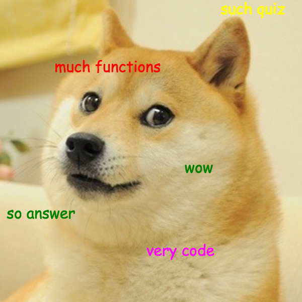
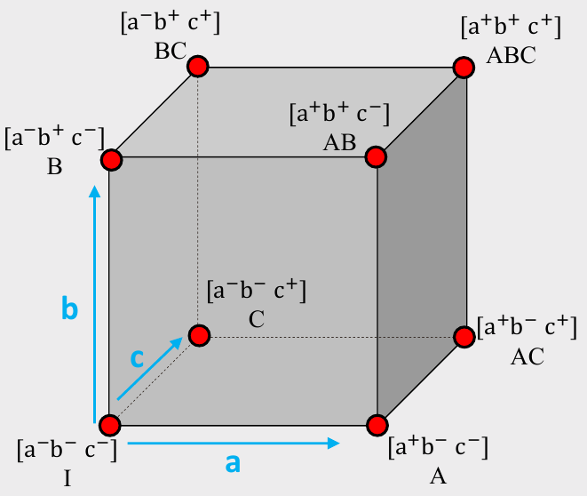
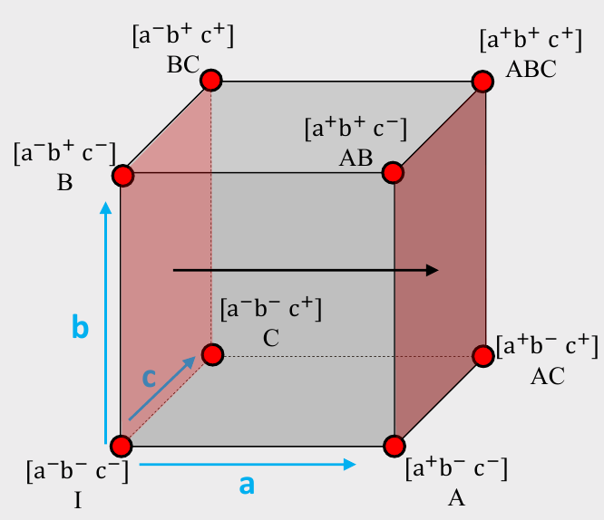
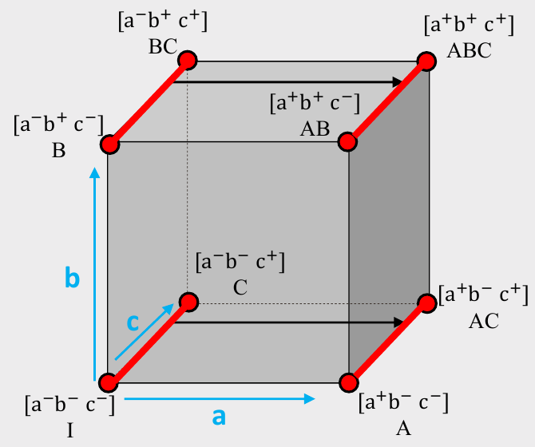



```{r}
#| include: false

agenda_items <- c(
  "Design of Experiment",
  "Design Efficiency",
  "Power Analysis"
)
```

---



# Quiz 4

```{r}
#| echo: false
countdown(
  minutes      = 12,
  warn_when    = 30,
  update_every = 1,
  top          = 0,
  right        = 0,
  font_size    = '3em'
)
```

::: {.col}

## Write your name on the quiz!

## Rules:

- Work alone; no outside help of any kind is allowed.
- No calculators, no notes, no books, no computers, no phones.

:::

::: {.col}

<br>
<center>

</center>

:::

---

```{r}
#| echo: false
#| output: asis
agenda(0)
```

---

```{r}
#| echo: false
#| output: asis
agenda(1)
```

---





# Main & Interaction Effects

---



# [Full design space for 3 effects: A, B, C]{.center}

<center>

</center>

---



# [Full design space for 3 effects: A, B, C]{.center}

::: {.col}

# Example: _Cars_

## A: Electric? (Yes+ or No-)
## B: Warranty? (Yes+ or No-)
## C: Ford? (Yes+ or No-)

:::

::: {.col}

<center>

</center>

:::

---




## Main Effects

::: {.col width="40%"}

$$
ME(a) =
$$

$$
\left( \frac{A + AB + AC + ABC}{4}\right) -
$$

$$
\left( \frac{I + B + C + BC}{4}\right)
$$

<br>

(A: Electric? Yes+ or No-)

:::

::: {.col width="60%"}

<center>

</center>

:::

---




## Interaction Effects

::: {.col}

$$
INT(ab) =
$$

$$
\frac{1}{2}\left[ \left( \frac{AB + ABC}{2}\right) - \left( \frac{B + BC}{2}\right) \right] -
$$

$$
\frac{1}{2}\left[ \left( \frac{A + AC}{2}\right) - \left( \frac{I + C}{2}\right) \right]
$$

:::

::: {.col}

<center>

</center>

:::

---

# [Example: Wine Pairings]{.center}

::: {.col width="40%"}

meat | wine
-----|------
fish | white
fish | red
steak | white
steak | red

:::

::: {.col .fragment width="60%"}

## Main Effects

1. `meat`: **Fish** or **Steak**?
2. `wine`: **Red** or **White**?

:::

---

# [Example: Wine Pairings]{.center}

::: {.col width="40%"}

meat | wine
-----|------
fish | white
fish | red
steak | white
steak | red

:::

::: {.col width="60%"}

## Main Effects

1. `meat`: **Fish** or **Steak**?
2. `wine`: **Red** or **White**?

## Interaction Effects

1. `meat*wine`: **Red** or **White** wine _with **Steak**_?
2. `meat*wine`: **Red** or **White** wine _with **Fish**_?

:::

---




# Open `interactions.qmd`

---





# Fractional vs Full Factorial Designs

---

## [Full Factorial Design]{.center}

::: {.col}

## Example: _Cars_

## A: Electric? (Yes+ or No-)
## B: Warranty? (Yes+ or No-)
## C: Ford? (Yes+ or No-)

:::

::: {.col .font80}

```{r}
library(cbcTools)

profiles <- cbc_profiles(
    electric = c(1, 0),
    warranty = c(1, 0),
    ford     = c(1, 0)
)
```

```{r}
#| eval: false

profiles
```

```{r}
#| echo: false

data.frame(profiles)
```

:::

---

## [Full Factorial Design]{.center}

::: {.col}

## Balanced?

All levels appear an equal number of times.

## Orthogonal?

All pairs of levels appear together an equal number of times.

:::

::: {.col .font80}

```{r}
library(cbcTools)

profiles <- cbc_profiles(
    electric = c(1, 0),
    warranty = c(1, 0),
    ford     = c(1, 0)
)
```

```{r}
#| eval: false

profiles
```

```{r}
#| echo: false

data.frame(profiles)
```

:::

---

## [Fractional Factorial Design]{.center}

::: {.col}

## Balanced?

All levels appear an equal number of times.

## Orthogonal?

All pairs of levels appear together an equal number of times.

:::

::: {.col .font80}

```{r}
#| eval: false

profiles[c(1, 3, 5, 6),]
```

```{r}
#| echo: false

data.frame(profiles[c(1, 3, 5, 6),])
```

:::

---




# Comparing Full and Fractional Factorial Designs

# Open `balance-orthogonality.qmd`

---



# Practice Question 1

::: {.col}

Consider the following experiment design

a | b | c | Effect
--|---|---|-------
+ | - | - | A
- | + | - | B
+ | - | + | AC
- | + | + | BC

:::

::: {.col}

a) Is the design balanced? Is is orthogonal?

b) Write out the equation to compute the main effect for a, b, and c.

c) Are any main effects confounded? If so, what are they confounded with?

:::

---

```{r}
#| echo: false
#| output: asis
agenda(2)
```

```{r}
#| include: false

# Designs behind the balance / overlap output on the next few slides.
# Computed live so the numbers can never drift from what cbcTools returns.
doe_profiles <- cbc_profiles(
  brand = c("GM", "BMW", "Ferrari"),
  price = c("20k", "40k", "100k")
)

doe_priors <- cbc_priors(
  doe_profiles,
  brand = c(BMW = 1, Ferrari = 2),
  price = c(`40k` = -1, `100k` = -4)
)

set.seed(42)
doe_small <- cbc_design(doe_profiles, n_resp = 1, n_alts = 3, n_q = 9)

set.seed(42)
doe_big <- cbc_design(doe_profiles, n_resp = 10, n_alts = 3, n_q = 9)

set.seed(42)
doe_opt <- cbc_design(
  doe_profiles,
  n_resp = 10, n_alts = 3, n_q = 9, n_blocks = 1,
  priors = doe_priors, method = "modfed", n_start = 5, use_idefix = FALSE
)

doe_price <- function(d) factor(d$price, levels = c("20k", "40k", "100k"))

counts <- function(d) {
  cat("Attribute counts:\n\nbrand:\n")
  print(table(d$brand))
  cat("\nprice:\n")
  print(table(doe_price(d)))
}

pairs_counts <- function(d) {
  cat("Pairwise attribute counts:\n\nbrand & price:\n")
  print(table(d$brand, doe_price(d)))
}
```

---

# [A simple conjoint experiment about _cars_]{.center}

Attribute | Levels
----------|----------
Brand     | GM, BMW, Ferrari
Price     | $20k, $40k, $100k

[**Design: [9]{.red} choice sets, [3]{.blue} alternatives each**]{.center}

. . .

::: {.col}

```{r}
#| echo: false
counts(doe_small)
```

:::

::: {.col .fragment}

```{r}
#| echo: false
pairs_counts(doe_small)
```

:::

---

# [A simple conjoint experiment about _cars_]{.center}

Attribute | Levels
----------|----------
Brand     | GM, BMW, Ferrari
Price     | $20k, $40k, $100k

[**Design: [90]{.red} choice sets, [3]{.blue} alternatives each**]{.center}

. . .

::: {.col}

```{r}
#| echo: false
counts(doe_big)
```

:::

::: {.col .fragment}

```{r}
#| echo: false
pairs_counts(doe_big)
```

:::

---

# [Bayesian D-efficient designs]{.center}

### [Maximize information on "Main Effects" according to priors]{.center}

. . .

Attribute | Levels | Prior
----------|-------------------|----------
Brand     | GM, BMW, Ferrari  | 0, 1, 2
Price     | $20k, $40k, $100k | 0, -1, -4

$$v_j = 1 \delta^{\mathrm{BMW}} + 2 \delta^{\mathrm{Ferrari}} -1 \delta^{\mathrm{40k}} -4 \delta^{\mathrm{100k}}$$

---

# [Bayesian D-efficient designs]{.center}

### [Maximize information on "Main Effects" according to priors]{.center}

Attribute | Levels | Prior
----------|-------------------|----------
Brand     | GM, BMW, Ferrari  | 0, 1, 2
Price     | $20k, $40k, $100k | 0, -1, -4

::: {.col}

```{r}
#| echo: false
counts(doe_opt)
```

:::

::: {.col .fragment}

```{r}
#| echo: false
pairs_counts(doe_opt)
```

:::

---



### Negative of the hessian evaluated at a set of parameters is called the **"Information Matrix"**

## $$\boldsymbol{I}(\boldsymbol{\beta}) = - \nabla_{\boldsymbol{\beta}}^2 \ln (\mathcal{L})$$

---



## "D-optimal" designs attempt to minimize the<br>"D-error" of a design

## $$D = |\boldsymbol{I}(\boldsymbol{\beta})| ^{-1/p}$$

where $p$ is the number of coefficients in the model

---

# [Getting the D-error of a design]{.center}

<br>

### `cbc_inspect()` and `cbc_compare()` report a design's D-error

. . .

### But only for designs built with a D-optimal method (`"stochastic"`, `"modfed"`, `"cea"`) - D-error gets computed _during_ the optimization

. . .

### So a random design has no D-error to report. To find out whether an efficient design beats a random one, we need [power analysis]{.orange}

---




# Finding Efficient Designs

# Open `design-efficiency.qmd`

---



```{r}
#| echo: false
countdown(
  minutes = 20,
  warn_when = 15,
  update_every = 1,
  top = 0,
  right = 0,
  font_size = '2em'
)
```

## Your Turn

1. Individually, create a Bayesian D-efficient fractional factorial survey design. Inspect the attribute balance and overlap.

2. Try all three D-optimal methods and compare them with `cbc_compare()`. Which gives the lowest D-error? Which is the most balanced?

3. Compare your results with your teammates.

---

```{r}
#| echo: false
#| output: asis
agenda(3)
```

---




# How many respondents do I need?

---




# How many respondents do I need<br>_to get X level of precision on $\boldsymbol{\beta}$_?

---

# Standard errors are inversely related to $\sqrt{N}$

::: {.col}

```{r}
#| label: uncertainty
#| fig-show: hide
n <- seq(100)
se <- 1/sqrt(n)
plot(n, se, type = "l")
```

Standard errors also decrease with:

- Fewer attributes
- Fewer levels in each categorical attribute
- More questions per respondent

:::

::: {.col}

```{r}
#| ref-label: uncertainty
#| echo: false
#| fig-height: 4.5
#| fig-width: 6
```

:::

---




## Using {cbcTools}, we can run simulations to determine the necessary sample size for a specific model

# Open `power-analysis.qmd`

---



```{r}
#| echo: false
countdown(
  minutes = 20,
  warn_when = 15,
  update_every = 1,
  top = 0,
  right = 0,
  font_size = '2em'
)
```

## Your Turn

::: {.col width="80%"}

Individually:

1. Using the survey design you created in the last practice, conduct a power analysis. Use `summary()` to find the sample size you need to reach 80% power (at $\alpha = 0.05$) on every parameter.

2. Re-run it with a more conservative set of priors. How much does your required sample size change?

3. Compare your results with your teammates.

:::
